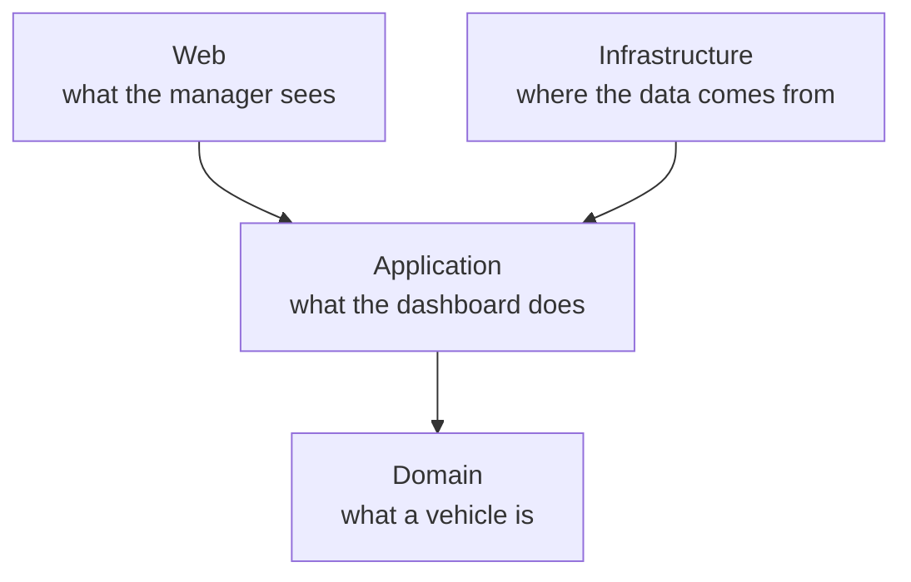
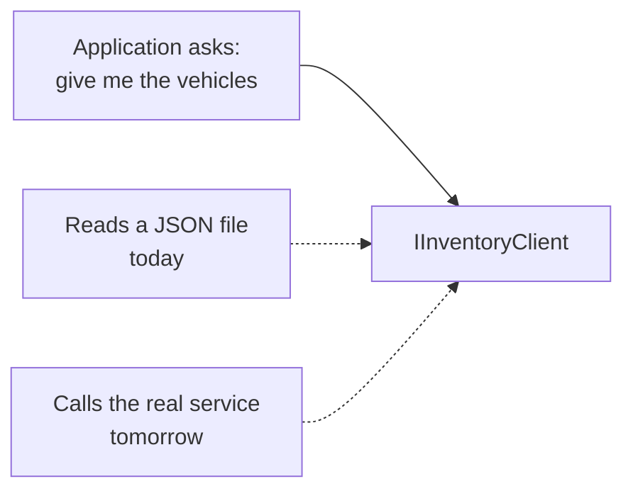
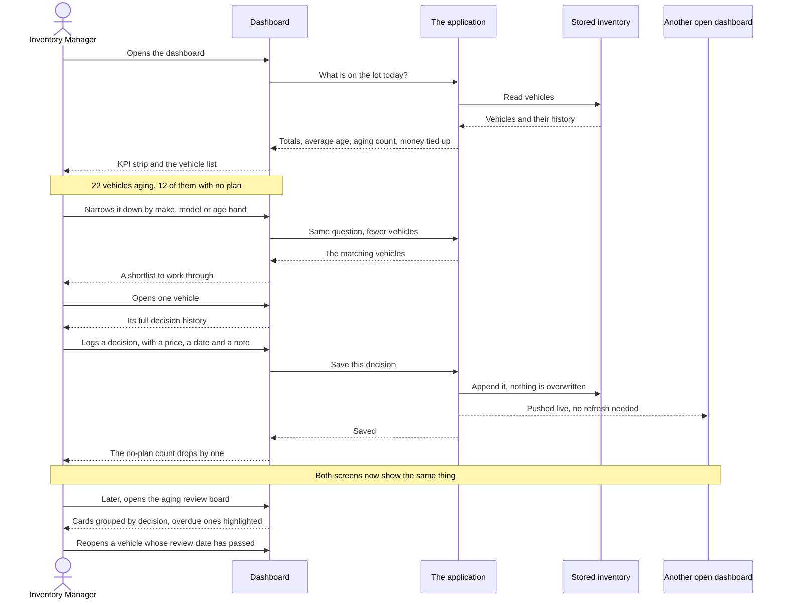

# System Design — Intelligent Inventory Dashboard

**Keyloop Technical Assessment · Scenario B (Domain: Supply)**
Nguyen Dang Phu Man · November 2026

---

## 1. Scope

A dealership manager opens one screen, sees the health of the whole lot, finds the
vehicles that have been sitting too long, and records what will be done about each one.

| Decision | This submission |
|---|---|
| **Scenario** | B — The Intelligent Inventory Dashboard |
| **Domain** | Supply |
| **Layer implemented** | **Frontend** — a Blazor Server application |
| **Layer mocked** | Backend — a JSON file behind the `IInventoryClient` port |

### What the brief asks for

| Requirement | How it is met |
|---|---|
| A filterable inventory list | A virtualised list with a branch selector, free-text search, filters on make, model and age band, three sort orders, and an age-distribution chart whose columns are themselves filters |
| Identify stock aging past 90 days | `AgingPolicy` — the single business rule. Aging vehicles are flagged in the list, counted and valued in the KPI strip, and can be viewed on their own |
| Log and persist an action | Each decision records a status, an optional proposed price, a review date and a note. The history is append-only and survives a restart |

---

## 2. Assumptions

The brief asks that ambiguous requirements be resolved with a stated assumption. These are
the four that would change the application's behaviour if read the other way.

1. **"More than 90 days" is strict.** A vehicle at exactly 90 days is *not* aging. Pinned
   by a test at 89 / 90 / 91 rather than left implied in the code.
2. **Four age bands, one threshold.** Fresh, Due soon, Aging, Critical. The brief fixes
   only the 90-day line; the other two give the manager a warning *before* a vehicle
   crosses it and an escalation tier well after. **Critical is a sub-band of aging**, so
   the oldest vehicles are still counted in every aging figure.
3. **More than one branch.** The design called for a branch selector, and a selector over
   single-branch data is a control that lies. The mock data covers two branches, and every
   figure on the screen follows the selection.
4. **No authentication.** In production this belongs to the platform gateway, not to this
   application. It is also why a logged decision carries a review *date* but no assigned
   owner — an owner needs a user identity this layer does not own.

---

## 3. Architecture

Four projects. In one sentence each:

| Project | Answers the question |
|---|---|
| **Domain** | *What is a vehicle, and when is it too old?* `Vehicle`, its append-only `VehicleAction` history, `AgingPolicy`, the enums. Plain C# — no Blazor, no files, no configuration — so the rule can be tested without starting anything. |
| **Application** | *What does this dashboard do with vehicles?* `InventoryQueryService` is the single entry point the screens call: fetch stock, apply `VehicleFilter`, compute the KPI figures. It also declares `IInventoryClient` — an interface saying *"somebody gives me vehicles"* without saying who. |
| **Infrastructure** | *Where do the vehicles actually come from?* `JsonInventoryClient` answers `IInventoryClient` by reading and writing the JSON file. The seed data, the live-update service, the telemetry and the CSV export live here too — everything that touches the disk, the network or the console. |
| **Web** | *What does the manager see?* Razor components and small view models that format what `Application` hands back. No business rules. |

**Read the arrows as "is compiled against", not "sends a request to".** This is the part
that trips people up, including me when I drew it badly the first time. `Infrastructure`
points at `Application` because it has to *know* the `IInventoryClient` interface in order
to implement it. At **runtime** the traffic goes the other way: `Application` asks for
vehicles and `Infrastructure` answers. The arrow and the phone call point in opposite
directions on purpose — that is what "dependency inversion" means in practice.

**`Infrastructure` is not between the screens and the rules.** `Web` and `Infrastructure`
are both outer layers, at the same distance from the middle: one talks to a person, the
other talks to a file. Neither names a type belonging to the other.

The only place the two meet is startup, where somebody has to say *"when something asks for
`IInventoryClient`, hand it `JsonInventoryClient`"*. That is one line in `Program.cs` and
it is not part of the layering — every page, component and view model is written against
the interfaces in `Application` alone.

### Replacing the mocked backend

`Application` asks for vehicles through `IInventoryClient` and never learns who answered.
Today a class that reads a JSON file answers it. Tomorrow a class that calls a Keyloop
service answers it instead, and nothing above it notices.

That swap is one new class. The screens, the rules and the tests are untouched — which is
the whole reason the interface exists.

This is the Dependency Rule, applied once where it pays for itself. What is deliberately
absent is the ceremony that usually comes with it: no mediator, no handler class per
action, no mapping tier between layers, no repository per entity. At two screens and one
business rule those cost real time and return nothing.

---

## 4. User flow

One morning in the life of an inventory manager: from opening the dashboard to a logged
decision, and back to that decision when its review date comes around.

Two details are worth pointing at:

**The loop closes.** A decision nobody revisits is paperwork. The last line of the diagram
is the point of the whole feature: the review board brings the manager back to a vehicle
when its review date passes, rather than ending at "saved".

**Saving pushes, it does not just store.** Because the app runs over an open connection
per user, an action logged in one window appears in every other open window immediately,
with no refresh. Two managers looking at the same lot never see different numbers.

---

## 5. Technology

| Choice | Why |
|---|---|
| **.NET / C#** | The stack I am fastest in, which under a two-day budget decides whether the submission is complete or partial. It is also a first-class stack at Keyloop. |
| **Blazor Server** | The scenario asks for a *real-time* overview. Blazor Server keeps an open connection to each browser, so pushing an update is native rather than bolted on — and it keeps one language across the UI, the rules and the tests. |
| **Hand-written markup and CSS** | No component library. The design is specified down to its colours and column widths, and matching that by overriding a library's theme is more work than writing the markup. Blazor's own `<Virtualize>` keeps a long list cheap to render. |
| **JSON file** | The mocked backend. The brief names *"static data, a mock API library, or a local JSON server"*; a file satisfies *persist across restarts* while staying honestly a mock. |
| **xUnit + bUnit** | xUnit for the rules; bUnit renders components in-process, so UI assertions run in milliseconds without a browser. |
| **OpenTelemetry + Serilog** | Traces, metrics and structured logs — the observability vocabulary Keyloop uses. |
| **GitHub Actions** | Builds and runs the tests on every push, so a green suite is demonstrable rather than claimed. |

---

## 6. Observability

If a manager says *"the dashboard is slow this morning"*, somebody has to be able to answer
why without guessing. Three kinds of signal are wired in for that.

- **Traces — where did the time go?** Each filter query and each saved action is recorded
  as a timed span carrying what was asked for and how many vehicles came back. A slow
  screen can then be attributed to the filtering, the file read, or the rendering, instead
  of being argued about.
- **Metrics — is it slow for everyone, or for one person?** Counters and timings
  aggregated across all users: how long filters take, how many people are connected, how
  many decisions get logged, how much stock is aging.
- **Logs — what happened in this one session?** Every log line carries an ID for that
  user's connection. This matters here specifically: a Blazor Server session is one
  long-lived connection rather than a series of separate requests, so without that ID an
  operator cannot reconstruct what one manager did.

Targets a team could hold itself to:

| What is measured | Target |
|---|---|
| How long a filter takes, for 95% of queries | under 300 ms |
| Reconnecting after a dropped connection | succeeds within 30 s, 99% of the time |
| A saved decision actually being stored | 99.9% of the time |

In this submission the signals print to the console so they can be demonstrated live. In
production one line changes — the exporter points at a collector instead.

---

## 7. Scalability, performance and reliability

The demo is one person, on one machine, with one file. A Keyloop customer is hundreds of
managers across dozens of sites, all day. So: *what breaks first, and what replaces it?*

**The trade-off I chose, stated plainly.** Blazor Server keeps each open browser's
connection and screen state **on the server**. That is exactly what makes live updates
nearly free — the server already knows who is looking at what. It is also the cost: server
memory and CPU grow with the number of people connected, and a user cannot be moved to a
different server in the middle of a session.

What that means in practice, and what the application already does about it:

- **A user must keep talking to the same server.** With more than one server, the load
  balancer has to send them back to the same one — or the connections move into a shared
  service (Azure SignalR, or Redis) so it stops mattering.
- **Connections drop; that is normal, not an error.** Wi-Fi dies, laptops sleep. Anything
  needed to rebuild a screen is fetched again on reconnect rather than assumed to still be
  in memory.
- **A long list does not mean a slow page.** Only the rows actually on screen are
  rendered, so a lot of any size costs the same to display.
- **Typing does not hammer the server.** Filter input waits 250 ms after the last
  keystroke before re-querying.
- **Two people saving at once cannot corrupt the file.** Writes are queued so they happen
  one at a time.

**What breaks first.** The JSON file. It lives on one machine, so the moment the app runs
on two servers they each have their own copy and the numbers drift apart. That is expected
— it is the mocked backend, and section 3 is built around replacing it: the file adapter
becomes an HTTP client to the real Inventory service, and the rules, the screens and the
tests do not change.

---

## 8. Testing

Tests were written for the places this application can actually be wrong, not to reach a
coverage percentage.

| What is tested | Why it is worth a test |
|---|---|
| 89 / 90 / 91 days | The brief says ">90". Exactly 90 is not aging, and that reading is pinned rather than assumed. |
| Every age band boundary, from both sides | Four bands means several places to be off by one. |
| The oldest stock is still counted as aging | The failure here is silent: the worst vehicles quietly disappearing from the aging view while every screen still looks correct. |
| Filters alone, filters combined, and filters matching nothing | A filter that silently returns everything is worse than one that errors. |
| "Aging" kept separate from "aging with nothing logged" | They drive different parts of the screen; conflating them makes the worklist meaningless. |
| An action survives a restart | Run against a real file, because "it persists" cannot be shown with an in-memory fake. |
| Many simultaneous saves all land | Without the write queue, decisions would be lost. |
| The demo data's shape | It is what a reviewer actually sees, so it is part of the deliverable. |
| The dashboard rendered end to end | Headline figures, aging flags, the chart used as a filter, a decision saved from a row, and the review board's drag-and-drop. Without these the suite would stay green through any layout at all. |

Two things make this possible. No test reads the system clock — "today" is always passed
in, which is what makes the aging rule testable at all. And the rule was written
**test-first**: the boundary tests were written and left failing before any implementation
existed.

---

## 9. GenAI in the design phase

**The pattern was always the same: I formed the idea, then used AI to attack it, and kept
what survived.** Not "ask the AI what to build" — every decision below started as mine.
What AI changed was how fast I found out which ones were wrong.

**Idea: Scenario B, built as the frontend.** I had picked it within ten minutes, on a
criterion of my own — *does the value of this scenario live in the layer I am
implementing?* So I handed the AI all four scenarios and that criterion, and asked it to
find the case against my answer. It could not; instead it hardened the argument by
pointing at the wording that settles Scenario D (*"the **backend** must make parallel
requests"* — choose the frontend and you remove the thing being assessed). A choice I
could now defend, rather than one I merely preferred.

**Idea: ports and adapters, with .NET and OpenTelemetry.** I wanted to know whether that
vocabulary would read as familiar at Keyloop or as my own habits. AI research confirmed
.NET as a first-class stack there, OpenTelemetry as the named observability tooling, and
Fusion organised into the same four domains the brief uses — so the design document could
speak the right language rather than a neutral one.

It also returned the one thing I did not want: **no public evidence of Blazor**, with
React named as their frontend framework. I kept that result and changed the submission
because of it — not the stack, which familiarity decides under a two-day deadline, but
section 7, which now confronts the Blazor Server trade-off instead of presenting the
choice as free. The check is only worth running if the inconvenient answer survives it.

**Idea: my own UI mock-up.** I designed the screens before building them. AI was useful
here as a reality check against the data actually behind each control — which is how four
elements came out: an owner on each decision (needs a user identity this layer does not
own), a "synced 2 minutes ago" label (the app pushes live, so the label would understate
it), week-on-week trend tiles (no time series exists, and inventing one makes every number
untrustworthy), and a branch selector over single-branch data. The first three stayed out.
The fourth I disagreed with myself about and **built**, after generating the mock inventory
across two branches — the objection was to a control that lies, not to the control.

**Twice the verification ran the other way.** The AI proposed SQLite with EF Core as the
more "professional" persistence, and I checked it against the brief: this path names only
data-level mocks, so a database would build the layer I was asked to mock. It also offered
"Clean Architecture" as a label for the early three-project structure, which had no
use-case layer — the label only became true once the four layers in section 3 existed.
Both times the rule was the same: the document describes the code, not the reverse.

**What made the execution better, not just faster.** Generated code is fluent by default,
and fluency is exactly what makes a wrong implementation hard to catch by reading. So the
aging rule was written test-first — boundary tests written and left **failing**, before any
implementation existed — and AI was pointed at my own code as a reviewer, where it found
things I had stopped seeing: a duplicated save-and-broadcast sequence that was hiding the
same two bugs twice, and derived properties being serialised into the store where nothing
would ever have failed.

**And the one time I skipped my own rule.** A confident explanation for a stale data file
fitted the symptom, and I wrote it into the README before checking it. It was wrong, and
one line of logging the app already had disproved it in a second. The failure was not the
file path — it was documenting a generated explanation before spending the second it would
have cost to falsify it.

The full narrative, including defects found in generated code, is in the
[README](../README.md#ai-collaboration-narrative).
